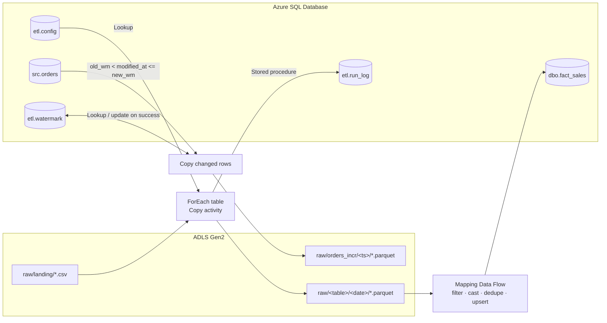

# Sales Data Pipeline on Azure Data Factory

Metadata-driven ELT on Azure. Raw sales CSVs land in ADLS Gen2, a parameterised Azure Data Factory pipeline copies them to Parquet, a Mapping Data Flow cleans and upserts them into Azure SQL Database, and a watermark pipeline loads only changed rows. Everything is defined as code in this repo and deployed with a script.



## What it does

| Pipeline | Pattern | Activities |
| --- | --- | --- |
| `PL_Ingest_Sales` | Metadata-driven ingestion | Lookup on `etl.config` → ForEach (parallel, batch 4) → Copy CSV to Parquet → Stored procedure logs rows to `etl.run_log` → Data Flow. Fail activities on the failure paths. |
| `DF_Transform_Orders` | Idempotent upsert | Source `raw/orders/*/*.parquet` → Filter null keys → Derived column (types, `amount = quantity × unit_price`) → Aggregate on `order_id` to dedupe → Alter row upsert → Sink `dbo.fact_sales` keyed on `order_id` |
| `PL_Incremental_Orders` | Watermark incremental load | Lookup old and new watermark → Copy only `old < modified_at <= new` → Stored procedure advances the watermark only on Copy success |
| `PL_Load_Orders_Window` | Tumbling-window load | Copy `src.orders` rows in `[window start, window end)` to `raw/orders_window/<yyyyMMdd>/` → log rows per window |
| `PL_Seed_SrcOrders` | One-off | Loads `orders.csv` into `src.orders` as the database source for the watermark pipeline |
| `TR_Daily_0200_JST` | Schedule trigger | Daily 02:00 Asia/Tokyo for `PL_Ingest_Sales`, deployed stopped |
| `TR_Tumbling_Orders_Daily` | Tumbling-window trigger | 24-hour windows from 19 to 26 Oct 2026 for `PL_Load_Orders_Window`, max concurrency 2, retry 2 × 30 s. Starting it backfills every past window. |

Adding a source table is one row in `etl.config`, not a new pipeline. Turning one off is `UPDATE etl.config SET is_active = 0`.

## Verified results

Run against a live factory (Japan East) with the sample data in `data/` (2,005 orders including 2 null keys and 3 duplicates):

| Check | Expected | Result |
| --- | --- | --- |
| Ingest: rows copied per table | orders 2,005 · customers 200 · dates 298 · products 10 | matched, logged in `etl.run_log` |
| `dbo.fact_sales` after first run | 2,000 | 2,000 |
| `dbo.fact_sales` after rerunning the same day | 2,000 (no duplicates) | 2,000 |
| Incremental, first run | 2,005 | 2,005 |
| Incremental, after updating 5 source rows | 5 | 5 |
| Incremental, no changes | 0 | 0 |
| Tumbling trigger backfill | 7 windows, each matching a direct SQL count | 7 succeeded; 8 · 7 · 4 · 8 · 8 · 7 · 7 rows, all equal to SQL |

## Design decisions

- **No secrets in the factory or in Git.** ADF reaches ADLS Gen2 and Key Vault with its system-assigned managed identity (Storage Blob Data Contributor, Key Vault Secrets User). The Azure SQL password is a Key Vault reference in `LS_AzureSql`.
- **Git integration.** The factory is connected to this repo (collaboration branch `main`, root folder `/adf`), so ADF Studio authors in feature branches and **Publish** generates ARM templates in `adf_publish`. `adf/` holds the dev factory's resource names; other environments override them with ARM template parameters.
- **Schedule vs tumbling window.** The schedule trigger fires a whole-pipeline run at a wall-clock time. The tumbling-window trigger gives each run a fixed, non-overlapping time window as parameters, which makes backfill and per-window reruns trivial.
- **Triggers stopped around deployment.** `deploy.sh` stops started triggers, deploys, then restarts them, the same job as Microsoft's pre/post-deployment script.
- **Generic, parameterised datasets.** Three datasets (`DS_ADLS_Csv`, `DS_ADLS_Parquet`, `DS_AzureSql_Table`) serve every table; container, folder, file, schema and table are passed in at run time.
- **Rerun safety.** Copies write to a dated folder that a same-day rerun overwrites, and the Data Flow upserts on the business key, so rerunning from a failed activity never duplicates rows.
- **Upper-bounded watermark.** The incremental Copy reads `modified_at <= new_wm`, captured before the copy starts, so rows written during the copy are picked up next run instead of being skipped. Watermarks pass through `CONVERT(varchar, ..., 121)` so no precision is lost between Lookup and SQL.
- **Retries where failures are transient.** Copy: 2 retries, 60 s apart, 30 min timeout, incompatible rows skipped and logged to `raw/_errors`. Data Flow: 1 retry after 120 s.
- **Copy vs Data Flow.** Plain format conversion stays in the Copy activity; only work that needs joins, dedupe or upserts pays for a Spark cluster.

## Lessons from building it

- **`az datafactory` silently dropped a `SecureString` password**, replacing it with an empty Key Vault reference, and the first run failed at Lookup. Deployment now PUTs the raw JSON through the ARM REST API (`az rest`), which is the same reason teams ship ADF with ARM templates rather than CLI wrappers.
- **A Data Flow cluster was cancelled during start-up** (`Cluster was in terminal state=[Cancelled]`), a transient platform failure. The retry policy on the activity now absorbs it.
- **Unquoted `$(ls ...)` broke deployment on a path with a space** ("Application Support"), and a polling loop then waited 15 minutes for runs that never started. The deploy script now uses globs and arrays.
- **Future-dated source timestamps break watermark loads.** The first sample data had `modified_at` values ahead of the current time, so the watermark jumped forward and genuinely updated rows were skipped. Guards: clamp the new watermark to the load time, or use change data capture.

## Repository layout

```
adf/                ADF resources in ADF Git layout ({"name", "properties"}), names as placeholders
  linkedService/    LS_ADLS (managed identity), LS_KeyVault, LS_AzureSql (password from Key Vault)
  dataset/          DS_ADLS_Csv, DS_ADLS_Parquet, DS_AzureSql_Table
  dataflow/         DF_Transform_Orders
  pipeline/         PL_Ingest_Sales, PL_Incremental_Orders, PL_Load_Orders_Window, PL_Seed_SrcOrders
  trigger/          TR_Daily_0200_JST, TR_Tumbling_Orders_Daily
sql/01_schema.sql   Control, log, fact, watermark and source tables + procedures (rerunnable)
data/               Sample CSVs (orders, customers, products, dates)
scripts/
  generate_data.py  Regenerates data/ with a fixed seed
  setup.sh          Provisions resource group, ADLS Gen2, Azure SQL, Data Factory, Key Vault, RBAC; uploads data
  deploy.sh         Applies the schema, deploys adf/ (stopping/restarting triggers), runs pipelines, starts triggers
  connect_git.sh    Connects the factory to this GitHub repo (Git mode)
  teardown.sh       Deletes the resource group
```

## Run it yourself

Needs an Azure subscription, the Azure CLI and `sqlcmd` (`brew install azure-cli sqlcmd`).

```bash
az login
./scripts/setup.sh
./scripts/deploy.sh --run PL_Ingest_Sales --run PL_Seed_SrcOrders --run PL_Incremental_Orders \
  --start-trigger TR_Tumbling_Orders_Daily
./scripts/connect_git.sh <your-github-account> <your-repo>
```

`setup.sh` generates its own resource names, so on your own subscription first point `adf/` at them: replace `214a8` in `adf/linkedService/*.json` with the suffix in your `lab.env`.

`setup.sh` writes generated resource names and the SQL password to `lab.env`, which is git-ignored. Cost for a full run of the lab is well under a few US dollars; the main cost is Data Flow cluster time. Delete everything with `./scripts/teardown.sh`.

## Tech

Azure Data Factory V2 · ADLS Gen2 · Azure SQL Database (serverless) · Mapping Data Flows · Azure Key Vault · Managed identity / Azure RBAC · GitHub integration · Azure CLI and ARM REST · T-SQL · Python
